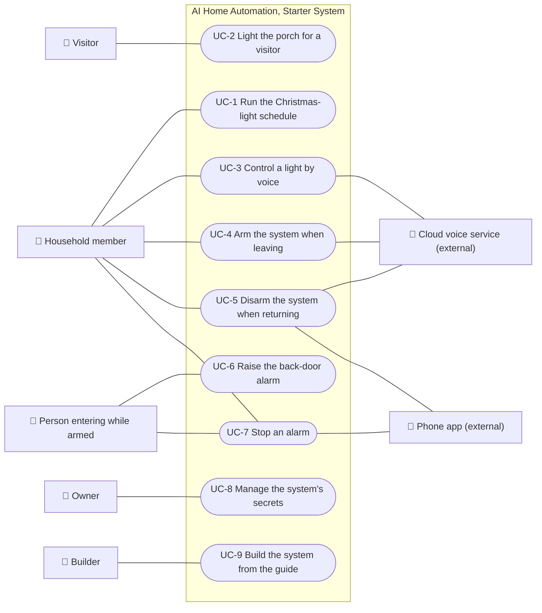

# AI Home Automation, Starter System: Product Requirements Document (PRD)

**Document:** d03-01 · **Step:** 3, Requirements · **Version:** 1.1
· **Last updated:** 2026-11-14 · **Status:** Approved
· **Owner:** Product Manager (Requirements chat)

**Diagrams included:** UML Use Case Diagram (required).
No situational diagrams. The alarm's states (disarmed, exit delay, armed,
entry delay, alarming) are left to a State Machine Diagram in the Spec
(Step 4), which the UML Diagram Guide assigns to the Software Architect.

## 1. Overview

| Item | Details |
|---|---|
| Product | AI Home Automation, Starter System (repo: ai_home_automation) |
| Problem | b0ts has no home automation system to learn on or to build later artificial intelligence (AI) projects on. A friend's Raspberry Pi system shows what's possible, but nobody has written down a path that others can repeat. |
| Proposed solution | A small home system that runs the Christmas lights on a schedule, lights the porch for visitors, obeys spoken light commands, arms and disarms a back-door alarm by voice, and comes with a public step-by-step guide so others can build the same thing. |
| Source documents | d02-01 one-pager v3.9, 2026-11-14 |
| Go decision | D4, 2026-11-14 (Tracking Checklist d01-01) |
| Conditions from stakeholders | One-time budget under $500 and at most $50 a month (D4); one project with one finish line; hardware assembled and sanity-tested in three stages before the build (d02-01); open issues I4 to I6 carried into Requirements (D4) |

## 2. Goals and Success Measures

| Goal | How success is measured | Target |
|---|---|---|
| Christmas lights | Plug turns on and off at the scheduled times, over 2 weeks | 14 of 14 days, each switch within 5 minutes of its scheduled time |
| Porch light | After dark: on within 2 seconds of an approach, off 10 minutes after the last motion; in daylight: stays off; over 2 weeks | 95% of approaches; 0 daytime turn-ons |
| Voice light control | Spoken on/off commands carried out | 9 of 10 |
| Leaving and returning | Arms 10 seconds after the command; disarms only with a household phone home or the right password; a wrong password leaves it armed | 10 of 10 each; 5 of 5 wrong-password tests |
| Back-door alarm | When armed: spoken alert and SOS flashing for 30 minutes or until stopped; when disarmed: nothing | 5 of 5 each, starting within 5 seconds after the 10-second entry delay ends *(revised, see Constraints)* |
| Within budget | Receipts and monthly bills | Under $500 one-time; at most $50 a month |
| Others can repeat it | The public repo contains a complete step-by-step build guide covering every hardware stage and every use case *(revised, see Constraints)* | Guide complete; both reviewers find no missing steps |

## 3. Users

| Actor | Type | Who they are | What they want to get done | What could get in their way |
|---|---|---|---|---|
| Household member | Primary | b0ts or his wife, the only two people living in the home. Each carries a phone that tells the system whether they're home. | Control the lights by voice; arm the system when leaving and disarm it when returning; stop an alarm; enjoy the Christmas-light schedule without touching it | The speakerphone is only near the front door; background noise; a phone that's flat or slow to report being home; forgetting the password |
| Builder | Primary | A hobbyist who finds the public repo, possibly with different Zigbee bulbs | Build a working copy of the system from the guide alone | Hardware that differs from b0ts's; steps that assume knowledge they don't have; no one to ask |
| Owner (administrator) | Secondary | b0ts, looking after the system | Set and change the password and the wake word, kept only on the home system; change the password after a guest has used it | Settings that are hard to find; accidentally exposing secrets in the public repo |
| Visitor | Secondary | Anyone walking up to the front door after dark, including guests | See their way to the door | The motion sensor can't see the approach |
| Person entering while armed | Secondary | Anyone who opens the back door while the system is armed: an intruder, a guest, or a household member | Avoid a false alarm, or else learn how to stop it (call the household, or give the password) | Not knowing the password; the 10-second entry delay is short |
| Phone app | External system | The app on both household phones | Report whether each phone is home; let a household member disarm the system remotely, from anywhere | Phone location lag; phone off or out of battery |
| Cloud voice service | External system | Turns speech after the wake word into commands the system understands | — | Internet outage (the system then stops working, which is accepted for this prototype) |

## 4. Use Case Diagram

## 5. Use Cases

### UC-1: Run the Christmas-light schedule

| Item | Details |
|---|---|
| Actor(s) | Household member (benefits); started by the time of day |
| Goal | The Christmas lights are on around dusk and before sunrise, every day, without anyone touching them |
| Priority | Must have |
| Phase | All |
| Starts when | A scheduled switch time arrives |
| Before it starts | The Christmas lights are plugged into the smart plug, and the system knows the home's location |

**Main flow:**

1. At sunset minus 30 minutes, the system turns the plug on.
2. Two hours later (sunset plus 90 minutes), the system turns the plug off.
3. At sunrise minus 2 hours, the system turns the plug on.
4. At sunrise, the system turns the plug off.
5. The schedule repeats every day, all year, with no seasonal limit.

**Alternate flows:**

- **1a. An alarm is in progress (UC-6):** the scheduled switch is held. When the alarm ends, the plug goes to the state the schedule calls for at that moment.
- **1b. A household member switched the plug by voice (UC-3):** the voice command holds until the next scheduled switch, which then happens as normal.
- **1c. The system restarts:** within 5 minutes of starting up, the plug is in the state the schedule calls for.

**Acceptance criteria:**

- [ ] Over 14 consecutive days, every scheduled switch happens within 5 minutes of its scheduled time on 14 of 14 days.
- [ ] After an alarm ends, the plug is in its scheduled state within 5 seconds.
- [ ] After a restart, the plug is in its scheduled state within 5 minutes.

### UC-2: Light the porch for a visitor

| Item | Details |
|---|---|
| Actor(s) | Visitor |
| Goal | The visitor can see their way to the front door after dark |
| Priority | Must have |
| Phase | All |
| Starts when | Someone moves within view of the front-door motion sensor |
| Before it starts | It is between sunset and sunrise |

**Main flow:**

1. The visitor approaches the front door.
2. The system turns the porch light on.
3. Each new motion restarts a 10-minute timer.
4. Ten minutes after the last motion, the system turns the porch light off.

**Alternate flows:**

- **1a. It is daylight (sunrise to sunset):** nothing happens.
- **2a. The porch light was turned on by voice (UC-3):** it stays on until turned off by voice; motion doesn't start a timer.
- **2b. An alarm is in progress (UC-6):** motion is ignored; the porch light keeps flashing SOS.

**Acceptance criteria:**

- [ ] Over 2 weeks, the porch light turns on within 2 seconds for at least 95% of approaches after dark.
- [ ] Over 2 weeks, the porch light turns on 0 times in daylight.
- [ ] The porch light turns off 10 minutes (give or take 30 seconds) after the last motion.

### UC-3: Control a light by voice

| Item | Details |
|---|---|
| Actor(s) | Household member; Cloud voice service |
| Goal | The porch light or the Christmas lights are on or off, as asked |
| Priority | Must have |
| Phase | All |
| Starts when | A household member says the wake word near the speakerphone |
| Before it starts | The internet is working |

**Main flow:**

1. The household member says the wake word.
2. The system signals that it is listening.
3. The household member says a command, such as "turn on the porch light" or "turn off the Christmas lights."
4. The system switches the named light.
5. The system gives a short spoken confirmation.

**Alternate flows:**

- **3a. The command isn't understood:** the system says it didn't understand, and nothing changes.
- **3b. The light name is unknown:** the system says it doesn't know that light, and nothing changes.
- **4a. The porch light is turned on by voice:** it stays on until a voice command turns it off (no motion timer).
- **4b. The Christmas lights are switched by voice:** the command holds until the next scheduled switch (UC-1, 1b).

**Acceptance criteria:**

- [ ] Out of 10 spoken on/off commands, at least 9 are carried out.
- [ ] Each command is carried out within 3 seconds of the person finishing speaking.
- [ ] No audio leaves the home system before the wake word is heard.
- [ ] The wake word is stored and detected only on the home system.

### UC-4: Arm the system when leaving

| Item | Details |
|---|---|
| Actor(s) | Household member; Cloud voice service |
| Goal | The back-door alarm is armed after everyone has left |
| Priority | Must have |
| Phase | All |
| Starts when | A household member says "Leaving the house" or "Arm the system" |
| Before it starts | The system is disarmed |

**Main flow:**

1. The household member says "Leaving the house" or "Arm the system."
2. The system announces a 10-second exit delay.
3. The household member leaves, by either door.
4. After 10 seconds, the system arms and announces it.

**Alternate flows:**

- **1a. The system is already armed:** it says so, and nothing changes.
- **3a. The back door opens during the exit delay:** no alarm.
- **3b. A disarm command is given during the exit delay:** arming is cancelled, and the system says so.

**Acceptance criteria:**

- [ ] Out of 10 arm commands, all 10 arm the system 10 seconds (give or take 1 second) after the command.
- [ ] Opening the back door during the exit delay never starts the alarm (5 of 5 tests).

### UC-5: Disarm the system when returning

| Item | Details |
|---|---|
| Actor(s) | Household member; Phone app; Cloud voice service |
| Goal | The system is disarmed without setting off the alarm |
| Priority | Must have |
| Phase | All |
| Starts when | The back door opens while armed, or a household member says "Returning to the house" or "Disarm the system" |
| Before it starts | The system is armed |

**Main flow:**

1. The household member opens the back door; the system starts a 10-second entry delay and asks for the system to be disarmed. (A person coming in through the front door skips this step, since only the back door has a sensor.)
2. The household member says "Returning to the house" or "Disarm the system."
3. The system checks whether either household phone is home.
4. A phone is home, so the system disarms and announces it.

**Alternate flows:**

- **3a. Neither household phone is home:** the system asks for the password. The person says it aloud. If it's right, the system disarms. If it's wrong, the system asks again, up to 3 tries in total.
- **3b. The third password try is wrong:** the alarm starts (UC-6).
- **2a. The entry delay runs out without a disarm:** the alarm starts (UC-6).
- **2b. Remote disarm:** a household member disarms from the phone app, from anywhere.

**Acceptance criteria:**

- [ ] Out of 10 disarms with a household phone home, all 10 disarm the system.
- [ ] Out of 10 disarms with no phone home and the right password, all 10 disarm the system.
- [ ] Out of 5 tests with one or two wrong passwords, all 5 leave the system armed.
- [ ] Out of 5 tests with three wrong passwords, all 5 start the alarm.
- [ ] Out of 5 remote disarms from the phone app, all 5 disarm the system.

### UC-6: Raise the back-door alarm

| Item | Details |
|---|---|
| Actor(s) | Person entering while armed |
| Goal | Anyone entering without disarming is warned and told how to stop it, and the alarm is visible from outside |
| Priority | Must have |
| Phase | All |
| Starts when | The entry delay runs out without a disarm, or the third password try is wrong |
| Before it starts | The system is armed |

**Main flow:**

1. The system announces the alarm and asks the person to call the household ("call us") to have it disarmed. The announcement gives no phone number.
2. The Christmas-light plug and the porch light flash SOS in Morse code.
3. The system repeats the announcement every 5 minutes.
4. After 30 minutes, the flashing and announcements stop, and the lights return to their previous state (UC-7, step 3).

**Alternate flows:**

- **1a. The system is disarmed:** opening the back door does nothing.
- **Any step. Someone stops the alarm (UC-7):** the alarm ends early.

**Acceptance criteria:**

- [ ] Out of 5 tests, all 5 start the spoken alert and SOS flashing within 5 seconds after the entry delay ends (or after the third wrong password).
- [ ] The announcement asks the person to call the household, gives no phone number, and repeats every 5 minutes (give or take 10 seconds).
- [ ] The flashing stops after 30 minutes (give or take 1 minute).
- [ ] Out of 5 tests with the system disarmed, opening the back door does nothing in all 5.

### UC-7: Stop an alarm

| Item | Details |
|---|---|
| Actor(s) | Household member; Person entering while armed; Phone app; Cloud voice service |
| Goal | The alarm stops and the home returns to normal |
| Priority | Must have |
| Phase | All |
| Starts when | Someone disarms the system while the alarm is in progress |
| Before it starts | An alarm is in progress (UC-6) |

**Main flow:**

1. Someone disarms the system in one of three ways: by voice with a household phone home, by voice with the password, or remotely from the phone app.
2. The system stops the flashing and the announcements.
3. The system returns the lights to their previous state and resumes the Christmas-light schedule.

**Alternate flows:**

- **1a. Wrong password during the alarm:** the system allows 3 more tries. After the third wrong try, it stops accepting voice disarm for the rest of this alarm; only the phone app can stop it, or it ends after 30 minutes.

**Acceptance criteria:**

- [ ] For each of the three disarm methods, 5 of 5 tests stop the alarm within 5 seconds.
- [ ] Out of 5 tests, all 5 return every light to its previous state, and the Christmas-light schedule resumes (UC-1).
- [ ] After 3 wrong passwords during an alarm, voice disarm is refused and the phone app still works (5 of 5).

### UC-8: Manage the system's secrets

| Item | Details |
|---|---|
| Actor(s) | Owner |
| Goal | The password and the wake word are set, and kept only on the home system |
| Priority | Must have |
| Phase | All |
| Starts when | The owner sets up the system, or wants to change a secret (for example, after a guest used the password) |
| Before it starts | The owner has access to the home system |

**Main flow:**

1. The owner chooses to change a secret.
2. The owner enters the new password or wake word.
3. The system saves it on the home system only.
4. The system uses the new value from then on.

**Alternate flows:**

- **2a. A guest has used the password:** the owner changes it as above, and the old password stops working.

**Acceptance criteria:**

- [ ] After a password change, the new password disarms the system and the old one doesn't (5 of 5).
- [ ] A search of the public repo, including its history, finds none of the password, the wake word or the home/away state.

### UC-9: Build the system from the guide

| Item | Details |
|---|---|
| Actor(s) | Builder |
| Goal | The builder has a working copy of the system |
| Priority | Must have |
| Phase | All |
| Starts when | The builder opens the guide in the public repo |
| Before it starts | Nothing |

**Main flow:**

1. The builder reads the parts list, with estimated costs.
2. The builder assembles and checks the hardware in three stages: the Raspberry Pi; the Zigbee devices; the speakerphone.
3. The builder installs and sets up the system software.
4. The builder sets up their own secrets (UC-8).
5. The builder sets up each use case (UC-1 to UC-7) and runs its check.

**Alternate flows:**

- **1a. The builder has different Zigbee bulbs or devices:** the guide explains how to pick compatible substitutes.
- **2a. A part doesn't work:** the guide points to troubleshooting notes and alternatives (for example, a voice puck instead of the speakerphone).

**Acceptance criteria:**

- [ ] The guide covers every hardware stage and every use case (UC-1 to UC-8), each ending with a check that tells the builder it works.
- [ ] The guide never tells the builder to put secrets in the repo.
- [ ] Both of b0ts's reviewers read the guide and report no missing steps.

## 6. Quality Requirements

| Area | Requirement |
|---|---|
| Speed | Porch light on within 2 seconds of motion; voice commands carried out within 3 seconds; alarm starts within 5 seconds after the entry delay; alarm stops within 5 seconds of a disarm |
| Reliability | As measured in Section 2 over 2-week trials. No backup power or offline operation: if the internet or power is down, the system is not expected to work (prototype). After power returns, the schedule recovers within 5 minutes. |
| Accessibility | Not required. This is a minimal prototype; the guide notes that builders with accessibility needs may need extra hardware and software in their own version. |
| Devices and browsers | The two household phones with the phone app; one speakerphone placed near the front door |
| Languages | English only. The guide notes that builders can add other languages in their own version. |
| Privacy and data | Voice audio after the wake word is sent to a cloud voice service, to understand commands. Whether each household phone is home is used to decide disarming. The password, the wake word and the home/away state are kept only on the home system, never on the web or in the public repo. No personal data is collected about visitors. |

## 7. Constraints

- One-time budget under $500 and at most $50 a month (D4; d02-01 section 5). The hardware total is still TBD (I4).
- Hardware already chosen or bought: Raspberry Pi 5 (8 GB) kit with a 1 TB solid-state drive (SSD), Zigbee coordinator, motion sensor, 4 Zigbee smart bulbs (single color; one for the porch, three kept for future projects), Shelly smart plug, a back-door sensor and a USB speakerphone (d01-01 Project Summary; d02-01 section 5).
- Approach follows James's system: Home Assistant OS on the Raspberry Pi, with Zigbee devices (d01-01 Project Summary). James's automation rules will be adapted if available, or written from scratch.
- Cloud AI may be used for this prototype, as in James's system (d02-01 section 3). A later project moves all AI on-premises.
- Hardware is assembled and sanity-tested in three stages before the build (d02-01 section 5), so the build can focus on use cases.
- Secrets and home/away state stay on the home system only, never on the web or in the repo (d02-01 section 7).
- The repo is public, under the MIT license (D2). Background notes stay out of the repo, and James's system is described only in general terms (D3, I3).
- This is a prototype, not a security system: one door sensor, no professional monitoring and no notifications (d02-01 section 7).
- **Change to an approved measure (D6, 2026-11-14):** "Others can repeat it" changes from "a second person builds a working system" to "the repo contains a complete build guide" (b0ts, 2026-11-14). Tracking's open question about a second person is closed.
- **Change to an approved measure (D6, 2026-11-14):** the back-door alarm now starts within 5 seconds *after a 10-second entry delay* (not within 5 seconds of the door opening), and also after 3 wrong passwords (b0ts, 2026-11-14).

## 8. Scope and Phases

**In scope:** UC-1 to UC-9

**Out of scope:**

- Away simulation (lamp or radio on while away): needs a second smart plug; deferred to a future project with more security sensors.
- Phone or text notifications, and professional 24-hour monitoring: this is a prototype, not a security system.
- More sensors, cameras or sirens: future expansion.
- On-premises AI and voice recognition: a later project.
- Backup power and working without the internet: future versions.
- Dimming and colored lights: the bulbs are single color; a future addition.
- Languages other than English, and accessibility hardware: left to builders' own versions.
- Support for other home automation hubs.
- A second person actually building the system from the guide: not needed for this project to be done.

Single phase.

## 9. Assumptions

- The back-door sensor works with the system's Zigbee network (I5). To confirm in the Step 6 hardware sanity test.
- A motion sensor can be placed to see the approach to the front door in all weather (I6). To confirm in Step 6.
- The phone app reliably reports whether each household phone is home, and can disarm the system from anywhere at no extra cost (b0ts, 2026-11-14). To confirm in Step 6.
- The USB speakerphone works for the wake word and voice commands near the front door; if not, a voice puck is sourced (d02-01 section 7).
- The smart plug and the porch bulb can flash SOS clearly enough to be read as Morse code (d02-01 section 7).
- Only the two household members know the password; anyone else who uses it is followed by a password change.
- The front door has no sensor, so entering through it never starts the entry delay.

## 10. Open Questions

None affect a Must-have use case's requirements.

- What is the hardware total, and does it fit under $500? (b0ts, by the Step 6 cost sign-off; I4)
- Does Claude Pro ($20 a month) count against the $50 monthly budget? (b0ts, by the Step 6 cost sign-off)
- Are James's automation rules available to adapt? (b0ts, by Step 4: Design)
- Which back-door sensor model, and how it joins the system, if the planned one isn't Zigbee (for Design to decide; I5)
- Which motion sensor, and where it goes, if the current one is indoor-only (for Design to decide; I6)
- How the system knows sunrise and sunset times, and how SOS timing is kept even (for Design to decide)

## 11. Change Log

| Version | Date | Change | Reason | Approved by |
|---|---|---|---|---|
| 1.0 | 2026-11-14 | First version | — | Not approved; sent back by D8 |
| 1.0 | 2026-11-14 | Recorded D6: the two success-measure changes in Section 7 are approved | Tracking review of v1.0 | b0ts (D6) |
| 1.0 | 2026-11-14 | Recorded D7: the 10-second entry delay with the speakerphone near the front door (I7), the year-round Christmas-light schedule, and SOS flashing on the smart plug (I8) accepted as written | Tracking review of v1.0 | b0ts (D7) |
| 1.1 | 2026-11-14 | The alarm announcement asks the person to call the household ("call us") without giving a number; the remote-disarm phone number is removed from the stored secrets (Section 3, UC-6, UC-8, Section 6) | D8: a person let in while the household is away will already have the number, so nothing need be stored or announced | b0ts (D9) |
