# AI Home Automation, Starter System: Software Design Specification (Spec)

**Document:** d04-01 · **Step:** 4, Design · **Version:** 1.0
· **Last updated:** 2026-11-15 · **Status:** Approved
· **Owner:** Software Architect (Design chat)

**Diagrams included:** System Overview; UML Sequence Diagram for every use
case (required). Situational diagrams: a **State Machine Diagram** for the
alarm, because its state (disarmed, exit delay, armed, entry delay, alarming)
changes how the system reacts to the door, to voice commands and to the
phone app, and the PRD assigns it to the Spec; and a **Component Diagram** of
the hardware, because the devices connect over four different links (USB,
Zigbee radio, home network, and the internet through Tailscale), which isn't
obvious from the System Overview (Tracking issue I1).

## 1. Overview

| Item | Details |
|---|---|
| Product | AI Home Automation, Starter System (repo: ai_home_automation) |
| Source PRD | d03-01, version 1.2, 2026-11-15 |
| PRD sign-off | D9, 2026-11-14 (version 1.1); version 1.2's sign-off is to be recorded in the Tracking chat with this Spec's review |
| Phase covered | All: UC-1 to UC-9 (single phase) |
| Application type | A home server: Home Assistant OS on a Raspberry Pi 5, configured with automations, with a USB speakerphone as the voice station and the Home Assistant phone app on the two iPhones; plus a step-by-step build guide in the public repo |
| Design in one sentence | Home Assistant on the Pi hears the wake word and a fixed set of spoken phrases through the speakerphone, keeps the alarm's state and the secrets on the Pi, switches the Zigbee plug and porch bulb in response to the time, motion, the back door, voice and the phone app, and is reached from outside the home only through Tailscale. |

## 2. Inputs

| Input | Source | Notes |
|---|---|---|
| Product Requirements Document | d03-01, version 1.2 (version 1.1 approved by D9; version 1.2 answers this Spec's requests R1 to R4) | Main input: 6 actors, 9 Must-have use cases |
| Constraints | PRD Section 7 | Under $500 one-time and $50 a month; Home Assistant OS on the Pi with Zigbee; cloud AI allowed; secrets only on the Pi; public MIT repo; James's system described only in general terms (D3) |
| Quality requirements | PRD Section 6 | Porch light within 2 s; voice commands within 3 s; alarm starts within 5 s after the entry delay and stops within 5 s; schedule recovers within 5 minutes of a restart |
| Existing technology | b0ts, Design chat, 2026-11-14 and 2026-11-15 | Raspberry Pi 5 (8 GB) kit with 1 TB USB SSD; SONOFF EFR32MG24 Zigbee coordinator; SONOFF SNZB-03PR2 motion sensor; Sengled Zigbee A19 bulbs; Shelly Plug US Gen4 (Zigbee mode); Shelly BLU Door/Window ZB (Zigbee mode); Jabra Speak 510 USB speakerphone (model PHS002W); two iPhones; Claude Pro and a Claude API key (not needed at run time with the chosen design) |
| Feasibility findings | d02-01 v3.9, Section 7 | Speakerphone setup risk; plug's Zigbee mode reportedly rough; SOS timing over Zigbee may be uneven; prototype, not a security system |
| Design options | d04-02 v1.0 | Voice setup: Option A, phrases on the Pi (b0ts, 2026-11-15) |
| Other | b0ts, Design chat, 2026-11-14 and 2026-11-15 | Remote access by Tailscale; password is a spoken code of digits; plug flashes 5 s on, 5 s off during an alarm (hardware wear); porch bulb keeps SOS; motion sensor and plug mounted under the eaves, replaced if the weather damages them; Pi and speakerphone by the front door. Hardware notes from b0ts's shopping chats (product pages, Zigbee2MQTT support) |
| Other | Vendor documents | Shelly Plug US Gen4 documentation (rated 10,000 switching cycles; indoor use only); Zigbee2MQTT device page for the Shelly SBDW-103C door sensor; Home Assistant voice documentation |

## 3. Design Approach

**Chosen approach:** A home server built on Home Assistant OS on the
Raspberry Pi, using Home Assistant's own automations, its built-in on-device
voice services, and its iPhone app. No custom web or phone app is built.

**Options considered:**

| Option | Main advantage | Main drawback | Chosen? |
|---|---|---|---|
| Home Assistant OS on the Pi, configured (YAML automations and add-ons) | Required by the PRD (Section 7); proven with these devices; phone app and voice services already exist | Limited to what Home Assistant and its add-ons can do; Home Assistant OS restricts custom software | Yes |
| Raspberry Pi OS or Ubuntu with Docker, plus Home Assistant in a container | More freedom (for example, a general Linux voice program) | No add-on store; more to set up and explain in the guide; differs from the approach the PRD fixes | No (kept as a later option for on-premises AI, as the project notes) |
| A custom program written from scratch | Full control | Far more work; re-creates what Home Assistant already does | No |

**Why:** The PRD fixes the platform (Section 7: Home Assistant OS on the Pi,
with Zigbee devices), and every use case can be built from Home Assistant's
standard parts, so there was no real choice of application type. The one
real choice was the voice setup, compared in d04-02: Option A (phrases on
the Pi) was chosen because it meets the 3-second target (UC-3 to UC-5,
UC-7), keeps the spoken password on the Pi (Section 6, Privacy) and costs
nothing a month.

## 4. System Overview

In this system, the **clients** (what people use) are the speakerphone voice
station, the Home Assistant app on the iPhones, and the Home Assistant web
page the owner uses for settings. The **application server** (which follows
the product's rules) is Home Assistant on the Pi. The **database** (where
information is stored) is Home Assistant's storage on the Pi's SSD. The
Zigbee devices are reached through Zigbee2MQTT.

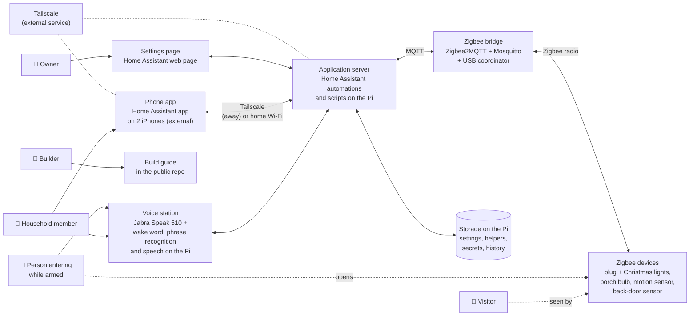

As in PRD version 1.2, no cloud voice service is used: all voice processing
is on the Pi (d04-02, Option A).

## 5. Components

### 5.1 Software components

| Component | What it is responsible for | Type of technology | Use cases it serves |
|---|---|---|---|
| Voice station | Listens through the speakerphone, hears the wake word, turns a known phrase into text, speaks replies and announcements | Home Assistant add-ons: Assist Microphone (uses the USB speakerphone as a voice satellite), openWakeWord (wake word), Speech-to-Phrase (fixed-phrase recognition), Piper (speech) | UC-3, UC-4, UC-5, UC-6, UC-7, UC-8 (wake word) |
| Application server | Runs every rule: the Christmas schedule, porch timer, voice commands, the alarm state machine (Section 12.1), disarm checks, SOS and flashing, restoring lights | Home Assistant Core: automations and scripts in YAML, sentence triggers, helpers (input_select, input_boolean, input_text, counter, timer), the sun integration | UC-1 to UC-8 |
| Storage | Keeps settings, helper values, the disarm code, the wake-word choice, device history, and the home location | Home Assistant's configuration files and built-in database (SQLite) on the SSD | UC-1 to UC-8 |
| Zigbee bridge | Pairs and talks to the Zigbee devices, and passes their messages to Home Assistant | Zigbee2MQTT add-on, Mosquitto MQTT broker add-on (MQTT is a light messaging system), SONOFF USB coordinator (DD-4) | UC-1, UC-2, UC-4 to UC-7 |
| Phone app | Reports whether each phone is home; lets a household member disarm from anywhere and see the alarm state | Home Assistant Companion app for iPhone (external system) | UC-5, UC-7 |
| Remote access | Lets the phones reach Home Assistant from outside the home, encrypted, with no open router ports | Tailscale add-on on the Pi and the Tailscale app on each iPhone (DD-3) | UC-5, UC-7 |
| Settings page | Lets the owner change the disarm code and choose the wake word | Home Assistant web page, owner account only | UC-8 |
| Build guide | Tells a builder how to buy, assemble, install and check everything | Markdown pages in the public repo (location and layout: for UI/UX to decide) | UC-9 |

### 5.2 Parts list

Prices are estimates seen during shopping, not quotes; the Step 6 Cost
Sign-Off Sheet (d06-03) confirms the totals (I4).

| Part | Role | Connects by | Estimated price | Status |
|---|---|---|---|---|
| Raspberry Pi 5, 8 GB | Runs everything | — | TBD (d06-03) | Bought |
| CanaKit Pi 5 case with active cooler | Protects and cools the Pi | — | $19.99 (seen) | Bought |
| Official Raspberry Pi 27 W USB-C power supply | Powers the Pi and its USB devices | USB-C | TBD (d06-03) | Bought |
| SanDisk 1 TB portable SSD and USB-A to USB-C cable | Holds Home Assistant OS and all data | USB 3 port (blue) | TBD (d06-03) | Bought |
| Micro-HDMI to HDMI cable | First-time setup with the monitor | Micro-HDMI | TBD (d06-03) | Bought |
| SONOFF EFR32MG24 Zigbee USB coordinator | The Zigbee radio | USB 2 port (black), on a short USB extension cable away from the SSD | TBD (d06-03) | Bought |
| USB extension cable, about 0.5 to 1 m | Keeps the coordinator away from USB 3 interference | USB | TBD | To buy (if not on hand) |
| Sengled Zigbee A19 bulbs, soft white, 4-pack | One porch bulb; three kept for later projects | Zigbee | $17.71 for 4 (seen) | Bought |
| SONOFF SNZB-03PR2 motion sensor | Sees the approach to the front door | Zigbee (battery) | TBD (d06-03) | Bought |
| Shelly Plug US Gen4 (S4PL-00116US) | Switches the Christmas lights; relays Zigbee signals | Zigbee (mains powered) | $24.99 (seen) | Bought |
| Shelly BLU Door/Window ZB (SBDW-103C) | Back-door sensor | Zigbee (battery) | $22.99 (seen) | Bought |
| Jabra Speak 510 (PHS002W) | Microphone and speaker at the front door | USB | $0 (already owned) | Owned |
| Powered USB hub | Only if the speakerphone or SSD draws too much power from the Pi | USB | TBD | Only if needed |
| Ethernet cable to the router | Network for the Pi | Ethernet | TBD | Assumed on hand |

### 5.3 How the devices connect

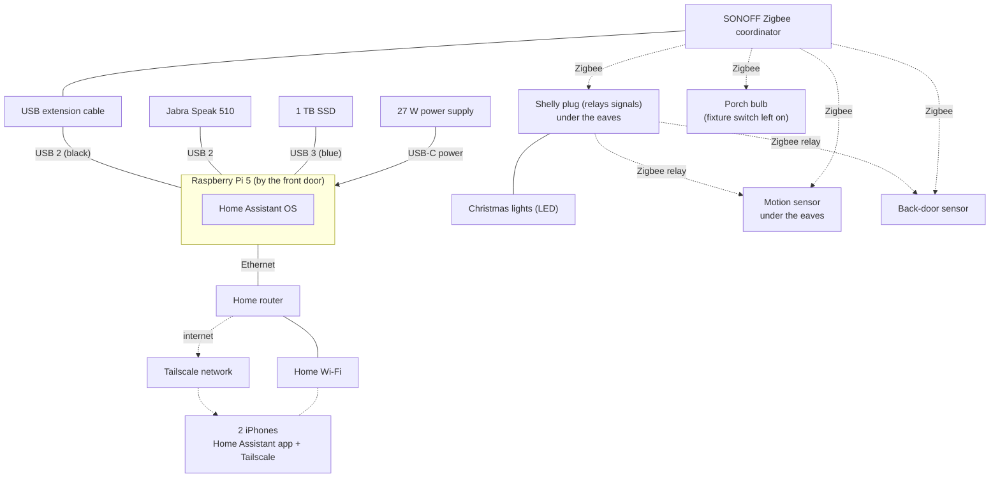

Notes for DevOps (Step 6):

- Pair the plug first: it's mains powered, so it can relay signals for the
  battery sensors. The Sengled bulbs reportedly don't relay, so the plug may
  be the only relay. The back door is the farthest device from a Pi by the
  front door; check its signal in the hardware test.
- The plug and the door sensor may arrive set to Wi-Fi or Bluetooth and need
  switching to Zigbee before pairing (for the door sensor, press its button
  5 times quickly).
- The Jabra Speak 510 also has Bluetooth, but Home Assistant OS's Bluetooth
  is meant for sensors, not audio. Moving the speakerphone away from the Pi
  would need a USB Bluetooth audio dongle (for example, a Jabra Link dongle)
  that the Pi sees as a USB audio device. Out of scope for this version.

### 5.4 Smart plug switching limits (I8)

Shelly rates the Shelly Plug US Gen4 for **10,000 switching cycles** (one
cycle is on and off once) and for **indoor use only**.

| Use | Cycles (estimate) | Plug life (estimate) |
|---|---|---|
| Christmas schedule (2 on/off cycles a day, all year) | About 730 a year | About 13 years from the schedule alone |
| SOS for 30 minutes (1-second Morse unit: 9 flashes every 34 seconds) | About 480 per alarm (about 950 at a 0.5-second unit) | About 20 alarms (about 10 at 0.5 s) |
| **Chosen:** 5 s on, 5 s off for 30 minutes | About 180 per alarm | About 55 alarms |

So the plug flashes a steady 5 seconds on, 5 seconds off during an alarm,
and only the porch bulb flashes SOS (DD-7; PRD change request R1 in
Section 16). The porch bulb is a solid-state LED with no relay, so SOS
switching is not expected to wear it the same way; b0ts has chosen to
watch it.

## 6. Data

| Item (entity) | What it holds | Personal information? | Kept for how long | Use cases |
|---|---|---|---|---|
| Alarm state | One of: disarmed, exit delay, armed, entry delay, alarming | No | Current value; history for 10 days (Home Assistant's default) | UC-4 to UC-7 |
| Disarm code | The spoken code of digits (4 digits proposed) | No, but **secret** | Until the owner changes it; never in history, logs or the repo | UC-5, UC-7, UC-8 |
| Wrong-code count | Wrong codes in the current disarm attempt or alarm | No | Reset at each disarm and each new alarm | UC-5, UC-7 |
| Voice-disarm lockout | Whether voice disarm is refused for the rest of this alarm | No | Until the alarm ends | UC-7 |
| Lights before the alarm | On/off state of the plug and porch bulb when the alarm started | No | Until the alarm ends | UC-6, UC-7 |
| Porch voice mode | Whether the porch light was turned on by voice (no motion timer) | No | Until turned off by voice | UC-2, UC-3 |
| Christmas voice hold | Whether a voice command is overriding the schedule | No | Until the next scheduled switch | UC-1, UC-3 |
| Porch timer and alarm timers | Time left on the porch 10-minute timer, exit and entry delays, 30-minute alarm, 5-minute announcement | No | While running | UC-2, UC-4 to UC-6 |
| Phone presence | Whether each household phone is home (from the phone app) | **Yes**: where a household member is | Current value; history for 10 days | UC-5, UC-7 |
| Home location | The home's latitude and longitude, for sunrise and sunset | **Yes**: the home address, in effect | Until changed | UC-1, UC-2 |
| Wake word choice | Which built-in wake word is used | No, but kept off the repo (PRD UC-8) | Until the owner changes it | UC-3, UC-8 |
| Device history | Motion, door, plug and bulb events | Partly: shows when people come and go | 10 days (Home Assistant's default) | UC-1 to UC-7 (troubleshooting) |
| Accounts | Home Assistant user accounts for the owner and the other household member | **Yes**: names | Until removed | UC-5, UC-7, UC-8 |
| Network secrets | Zigbee network key, Tailscale login | No, but **secret** | Until changed | All |
| Voice audio | Speech after the wake word | **Yes** | Not stored: processed on the Pi and discarded | UC-3 to UC-5, UC-7 |

## 7. Client–Server Interface

Voice requests are fixed phrases recognized on the Pi. Phone app and
settings requests go to Home Assistant over its normal secure connection
(Tailscale when away). Device messages travel between Home Assistant and
Zigbee2MQTT over MQTT.

| Request | From → To | Sends | Returns when it works | Returns when it fails | Use cases |
|---|---|---|---|---|---|
| Wake | Voice station → Server | Wake word heard (no audio leaves the Pi) | Listening sound | Nothing (wake word not heard) | UC-3 to UC-5, UC-7 |
| Light command | Voice station → Server | "Turn on/off the porch light / the Christmas lights" | Light switched; spoken confirmation | "Sorry, I didn't understand" or "I don't know that light"; nothing changes | UC-3 |
| Arm command | Voice station → Server | "Leaving the house" or "Arm the system" | "Arming in 10 seconds", then "System armed" | "The system is already armed" | UC-4 |
| Disarm command | Voice station → Server | "Returning to the house" or "Disarm the system" | "System disarmed" (a phone is home) or "Please say your code" | "Voice disarm is locked; use the phone app" (lockout) | UC-4 (cancel), UC-5, UC-7 |
| Code | Voice station → Server | "Code" followed by the digits | "System disarmed" | "Wrong code, please try again" (tries left) or the alarm starts / lockout | UC-5, UC-7 |
| Speak | Server → Voice station | Text to say (reply or announcement) | Spoken through the speakerphone | Logged; the rule carries on | UC-3 to UC-7 |
| Location update | Phone app → Server | Phone is home or away | Presence updated | Last known value kept (phone off or out of reach) | UC-5, UC-7 |
| Remote disarm | Phone app → Server | Disarm button (signed-in household account) | Alarm state "disarmed" shown in the app | "Couldn't reach home" in the app (Tailscale off or no internet) | UC-5, UC-7 |
| Show alarm state | Phone app → Server | Open the dashboard | Current alarm state | Last cached view | UC-4 to UC-7 |
| Change code | Settings page → Server | New code (owner account only) | "Saved"; new code works, old one doesn't | Rejected if not digits or wrong length | UC-8 |
| Change wake word | Settings page → Server | Choice from the built-in list | Saved; used from the next wake | Not saved | UC-8 |
| Motion detected | Zigbee bridge → Server | Motion sensor occupied | Porch rule runs | Missed if the sensor's battery or signal fails (shown as unavailable) | UC-2 |
| Door opened | Zigbee bridge → Server | Back-door sensor open | Alarm rule runs | Missed if the sensor is unavailable (see Risks) | UC-4 to UC-6 |
| Switch plug | Server → Zigbee bridge | Plug on or off | Plug state report | Retried once; then logged | UC-1, UC-3, UC-6, UC-7 |
| Switch porch bulb | Server → Zigbee bridge | Bulb on or off | Bulb state report | Retried once; then logged | UC-2, UC-3, UC-6, UC-7 |
| Sun event | Server (sun integration) → Server | Sunrise or sunset, with offset | Christmas rule runs | — (calculated on the Pi; no internet needed) | UC-1, UC-2 |
| Timer finished | Server → Server | Which timer ended | Rule for that timer runs | Timers resume after a restart | UC-1, UC-2, UC-4 to UC-6 |

## 8. Use Case Coverage

| Use case (PRD) | Priority | Sequence diagram | Components involved | Requests used |
|---|---|---|---|---|
| UC-1: Run the Christmas-light schedule | Must have | Section 9, UC-1 | Server, Storage, Zigbee bridge, plug | Sun event, Switch plug, Timer finished |
| UC-2: Light the porch for a visitor | Must have | Section 9, UC-2 | Server, Storage, Zigbee bridge, motion sensor, porch bulb | Motion detected, Switch porch bulb, Timer finished |
| UC-3: Control a light by voice | Must have | Section 9, UC-3 | Voice station, Server, Storage, Zigbee bridge | Wake, Light command, Switch plug, Switch porch bulb, Speak |
| UC-4: Arm the system when leaving | Must have | Section 9, UC-4 | Voice station, Server, Storage, door sensor | Wake, Arm command, Disarm command, Door opened, Speak, Timer finished |
| UC-5: Disarm the system when returning | Must have | Section 9, UC-5 | Voice station, Server, Storage, door sensor, Phone app, Remote access | Door opened, Wake, Disarm command, Code, Location update, Remote disarm, Speak |
| UC-6: Raise the back-door alarm | Must have | Section 9, UC-6 | Server, Storage, Zigbee bridge, plug, porch bulb, Voice station | Timer finished, Switch plug, Switch porch bulb, Speak |
| UC-7: Stop an alarm | Must have | Section 9, UC-7 | Voice station, Phone app, Remote access, Server, Storage, Zigbee bridge | Disarm command, Code, Remote disarm, Switch plug, Switch porch bulb, Speak |
| UC-8: Manage the system's secrets | Must have | Section 9, UC-8 | Settings page, Server, Storage, Voice station | Change code, Change wake word |
| UC-9: Build the system from the guide | Must have | Section 9, UC-9 | Build guide, all components | All, as checks |

No use case is without a design. Every component and request above serves
at least one use case. Nothing in the design is unused.

## 9. Sequence Diagrams

Participants: **Person** (the actor), **Voice** (voice station), **App**
(phone app), **HA** (application server), **DB** (storage on the Pi),
**Z2M** (Zigbee bridge), and the devices.

### UC-1: Run the Christmas-light schedule

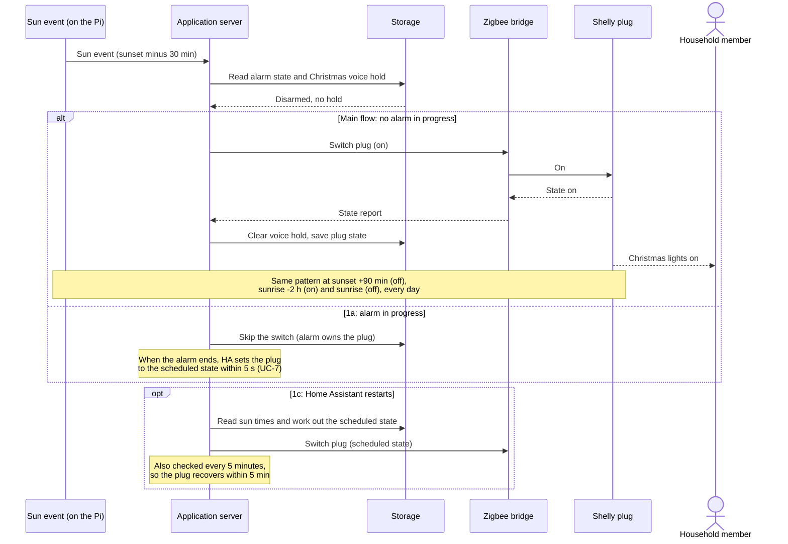

**Notes:** Sunrise and sunset are calculated on the Pi by Home Assistant's
sun integration from the home location (DD-8), so no internet service is
needed. A voice command (UC-3) sets the "Christmas voice hold" until the next
scheduled switch, and the 5-minute check doesn't undo it (UC-1, 1b).

### UC-2: Light the porch for a visitor

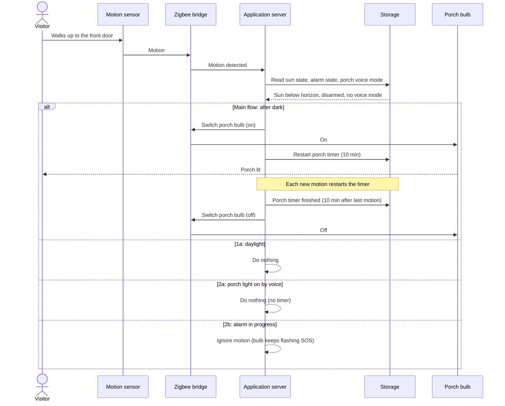

**Notes:** The motion sensor's own detection interval is set to its minimum
(5 seconds), so a visitor who stays in view keeps restarting the timer. The
whole path is local (sensor, Zigbee, MQTT, Home Assistant, Zigbee, bulb),
well under the 2-second target (estimate; measured in Step 7).

### UC-3: Control a light by voice

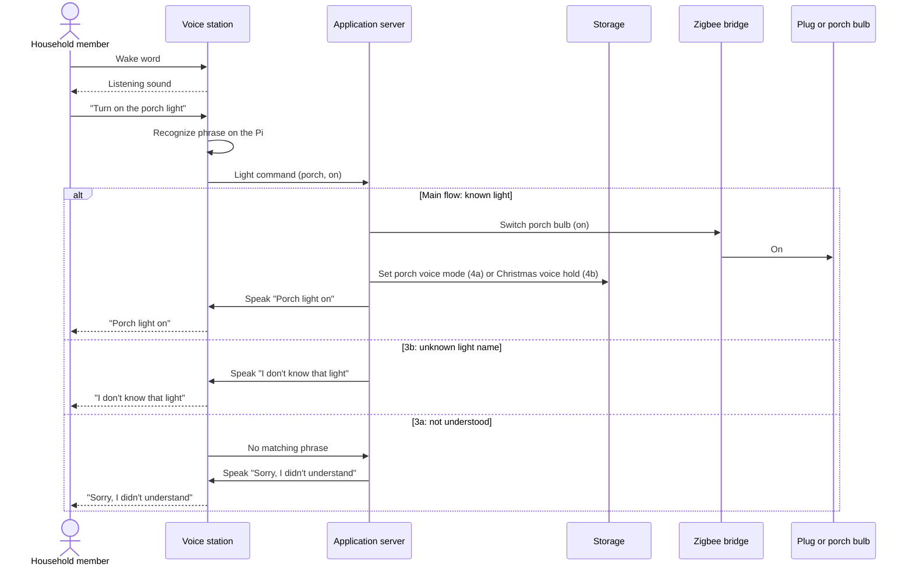

**Notes:** No audio leaves the Pi: the wake word, phrase recognition and
speech all run on it. Because a phrase-only recognizer always picks the
closest known phrase, the phrase list includes common light names this
house doesn't have ("kitchen light", "living room light" and so on), which
lead to "I don't know that light" rather than switching the wrong light
(DD-11).

### UC-4: Arm the system when leaving

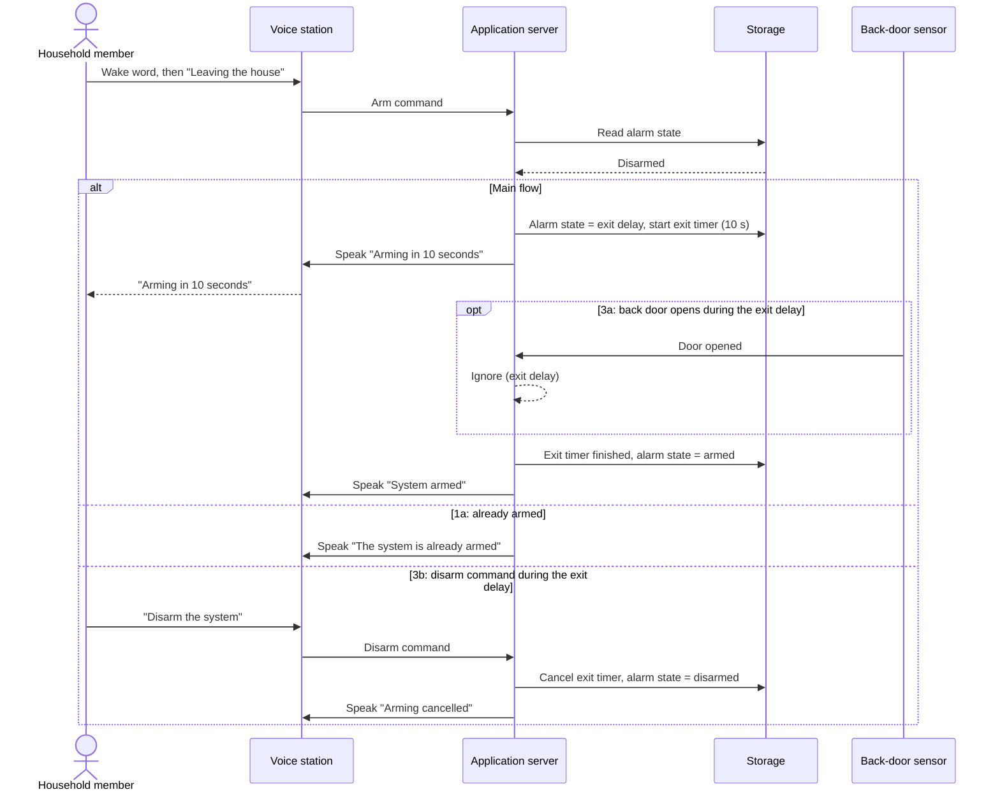

**Notes:** Cancelling during the exit delay doesn't need a phone home or
a code, because the system was never armed.

### UC-5: Disarm the system when returning

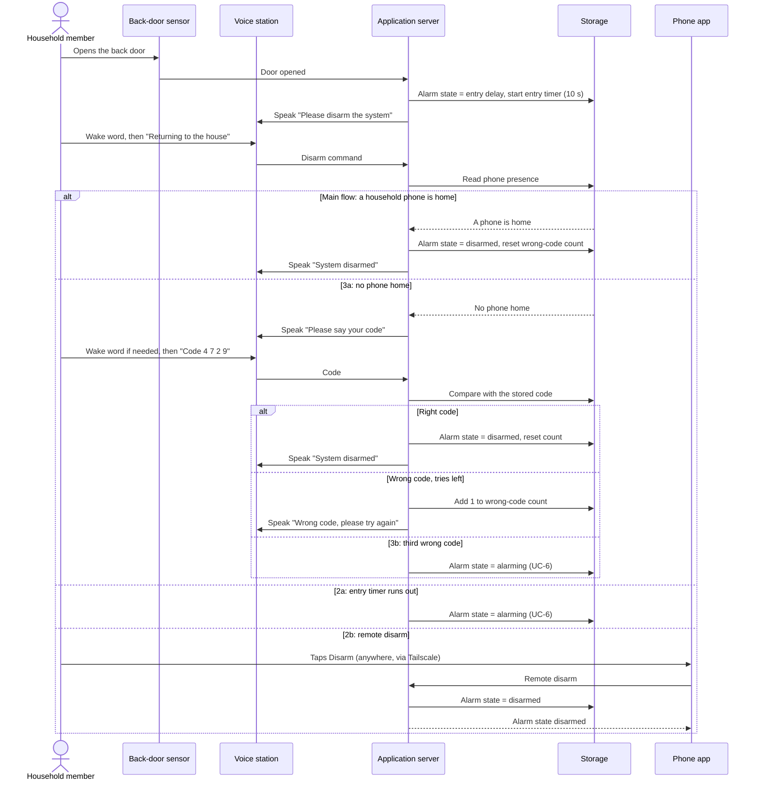

**Notes:** Someone entering by the front door (no sensor) starts at the
voice step with the system still armed, with no entry delay. The same checks
apply. A wrong code isn't read back aloud. The code is never stored in
history or logs.

### UC-6: Raise the back-door alarm

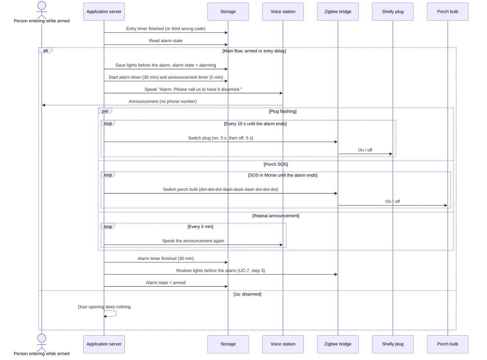

**Notes:** The plug flashes a steady 5 seconds on, 5 seconds off rather than
SOS, to protect its relay (Section 5.4, DD-7, request R1). The SOS unit is
1 second (estimate; tuned in Step 6 so the Morse reads clearly over Zigbee).
After 30 minutes the system goes back to **armed**, so a second entry is
still detected (DD-12). The alarm can end early by UC-7 at any step.

### UC-7: Stop an alarm

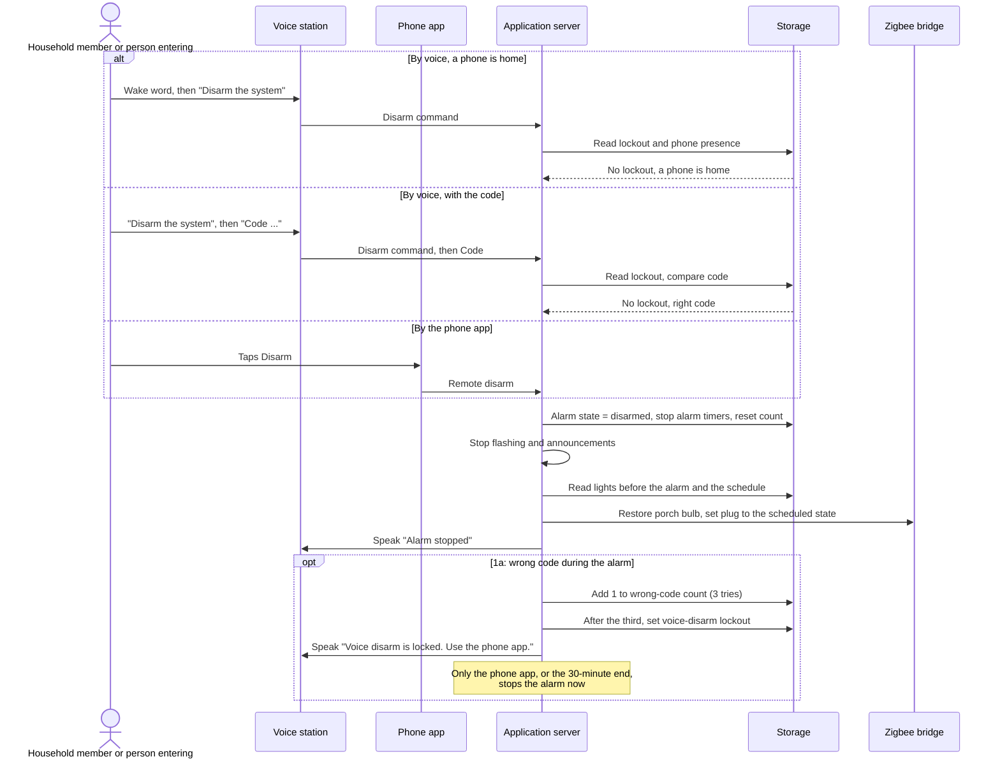

**Notes:** All three methods share one "disarm" script, so they all stop the
alarm the same way, within 5 seconds (estimate; measured in Step 7).

### UC-8: Manage the system's secrets

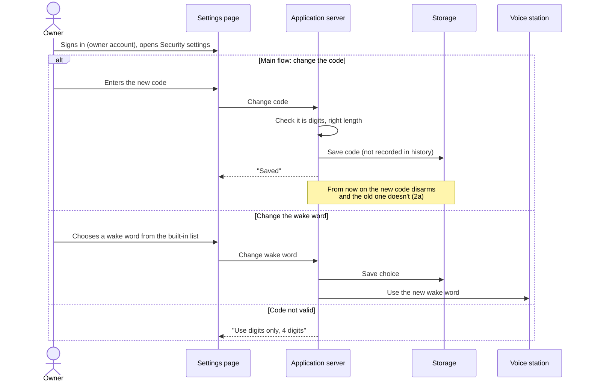

**Notes:** Both secrets live only in the Pi's storage. The repo holds only
placeholders. The owner can change them from home or, through Tailscale,
from anywhere. The settings page layout is for UI/UX to decide.

### UC-9: Build the system from the guide

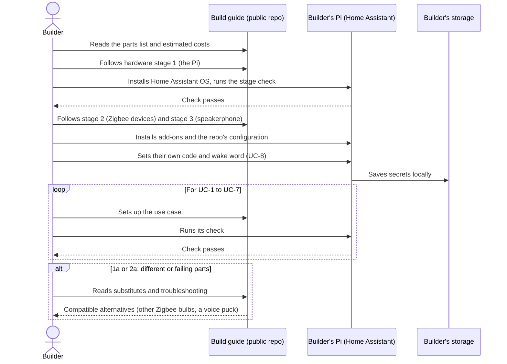

**Notes:** The repo's configuration uses placeholders for every secret and
for the home location. The guide never asks the builder to put secrets in
the repo (UC-9 acceptance criteria).

## 10. Quality Requirements: How They Are Met

| Area | PRD requirement | How the design meets it |
|---|---|---|
| Speed | Porch light on within 2 s of motion; voice commands within 3 s; alarm starts within 5 s after the entry delay; alarm stops within 5 s of a disarm | Everything runs on the Pi with no internet step. Speech-to-Phrase is reported at about 150 ms per command on a Pi 5. Zigbee commands are local. Alarm start and stop are driven by timers and one shared script. All four are measured in Step 7. |
| Reliability | As measured in Section 2 over 2-week trials; no backup power or offline operation; schedule recovers within 5 minutes after power returns | Home Assistant starts automatically on the SSD. On start and every 5 minutes it sets the plug to the scheduled state. Timers survive restarts. Voice and lights also work without the internet (a bonus). The phone app needs the internet when away. Backups: for DevOps to decide. |
| Accessibility | Not required | Not required. The guide notes that builders may add accessibility hardware and software. |
| Devices and browsers | Two household phones with the phone app; one speakerphone near the front door | Home Assistant Companion app on both iPhones, plus the Tailscale app. Jabra Speak 510 on USB by the front door, with the Pi. |
| Languages | English only | English phrases, an English voice (Piper) and English wake words. The guide notes that builders can add languages. |
| Privacy and data | No voice audio leaves the home system; phone presence used for disarming; password, wake word and home/away state kept only on the home system; no visitor data | No audio leaves the Pi: the wake word, phrase recognition and speech all run on it. Phone presence travels only between the phones and the Pi, encrypted (Tailscale or the home network). Secrets stay on the Pi (Section 11). The motion sensor records only "motion" events, not who. |

## 11. Security & Compliance

### 11.1 Protecting Information

| Information | Who may see or change it | How it is protected |
|---|---|---|
| Disarm code | Owner may change it. Nobody can read it back. The system only compares it. | Stored on the Pi only, in a password-type field, left out of history and logs. Never in the repo: the repo's `.gitignore` covers `secrets.yaml` and other local secret files (for DevOps to set). Never spoken back. |
| Wake word choice | Owner | Stored on the Pi only. The repo's configuration names no wake word. |
| Alarm state | Household members (app), owner (settings) | On the Pi only. Shown in the app over Tailscale. |
| Phone presence | Household members and owner | Sent from the phones to the Pi only, encrypted (home network or Tailscale). History kept 10 days. |
| Home location | Owner | On the Pi only. The repo uses a placeholder. |
| Zigbee network key | Owner | On the Pi only. Generated at setup. Never in the repo. |
| Tailscale login | Owner | On the Pi and the phones. Never in the repo. |
| Voice audio | Nobody | Processed on the Pi and not stored |
| Device history | Household members and owner | On the Pi only. 10-day history. |

**Sign-in and permissions:** Everyone using the phone app or the settings
page signs in to Home Assistant with their own account: an **owner**
(administrator) account for b0ts, and a non-administrator account for the
other household member. Two-step sign-in (a code from an authenticator
app) is recommended for both accounts. Home Assistant is reachable from
outside only through Tailscale, which allows only the household's signed-in
devices, so there are no open ports on the router. The voice station needs no
sign-in. Instead, voice disarm requires a household phone at home or the
code. Changing secrets is owner-only.

### 11.2 Copyright and Data Sources

| Content or data | Source | May we use it? | Conditions |
|---|---|---|---|
| Home Assistant OS and Core | Open Home Foundation (open source) | Yes | Apache License 2.0. We configure it and don't redistribute it. |
| Zigbee2MQTT | Open-source project | Yes | GPL-3.0. Installed as an add-on, not redistributed. |
| Mosquitto MQTT broker | Eclipse Foundation | Yes | EPL-2.0 / EDL-1.0. Installed as an add-on. |
| openWakeWord and its built-in wake-word models | Open-source project | TBD | Code: Apache 2.0. The pre-trained models are believed to be under a non-commercial licence (CC BY-NC-SA 4.0). Fine for personal use, but to be confirmed, and the guide should tell builders. |
| Speech-to-Phrase | Open Home Foundation | TBD | Licence to be confirmed. Installed as an add-on, not redistributed. |
| Piper and its voice | Open Home Foundation / voice dataset authors | TBD | Each voice has its own licence. Confirm the chosen English voice's licence. |
| Tailscale | Tailscale Inc. (service) | Yes, under its terms | Free personal plan. Terms to be read by the owner. |
| Sunrise and sunset times | Calculated on the Pi from the home location | Yes | No outside data source |
| Product facts in the guide (part names, ratings) | Manufacturers' public pages | Yes, as facts | Link to the source. Don't copy product photos or long text. |
| Reference system details | James (private notes and answers) | Only in general terms | Kept out of the repo (D3, I3). Nothing copied word for word. |
| AI-written configuration, code and guide text | Claude (Claude Code and Claude chats) | Yes | Reviewed by a person before commit (Section 11.4). Must not reproduce copyrighted text or other people's configuration. |

### 11.3 Laws and Rules

| Law, rule, or policy | What it requires | How the design complies |
|---|---|---|
| PRD Section 7: secrets and home/away state only on the home system | Nothing secret on the web or in the repo | Secrets on the Pi only. `.gitignore` and placeholders. A secret scan of the repo and its history before each push (UC-8 acceptance criterion; tool for DevOps to decide). |
| PRD Section 7: public repo under the MIT licence (D2) | Content we publish must be ours to licence | The guide and configuration are original. Third-party software is installed, not copied in. Licences are listed in the guide. |
| PRD Section 7: James's system described only in general terms (D3) | Keep the background notes private | No reference-system details in any repo document. |
| PRD Section 7: prototype, not a security system | Must not be presented as a monitored alarm | The guide and announcement make no claim of monitoring. No calls or notifications to outside parties. |
| Recording and privacy laws (California) | Recording conversations can need consent | No audio is stored or sent anywhere. Wake-word listening happens only on the Pi. A qualified person should confirm if this matters to a builder in another place. |
| Local alarm-permit rules | Some cities require permits for alarm systems | This system has no siren, monitoring or police dispatch. Whether any local rule applies is a legal question for a qualified person. Not legal advice. |

### 11.4 AI-Related Risks

- **No secrets in AI tools:** the disarm code, the Tailscale login, the
  Zigbee network key and the home location are never pasted into a Claude
  chat or Claude Code session. Claude Code works on the repo's placeholder
  configuration only, and must not open `secrets.yaml` or the Pi's storage
  (to be written into CLAUDE.md by DevOps).
- **The reference system stays private:** James's answers are read by b0ts
  and summarized into design decisions in general terms. They aren't pasted
  into repo documents.
- **AI-written work is checked:** every configuration file and guide page
  written with Claude goes through the workflow's reviews (Step 8 code
  review, polishing, and hands-on review), and b0ts decides on every
  finding before it's merged. The guide is read by both reviewers
  (UC-9).
- **No AI at run time:** with Option A, the running system sends nothing to
  any AI service, so no household data reaches one.

## 12. Situational Diagrams

### 12.1 State Machine Diagram: the alarm

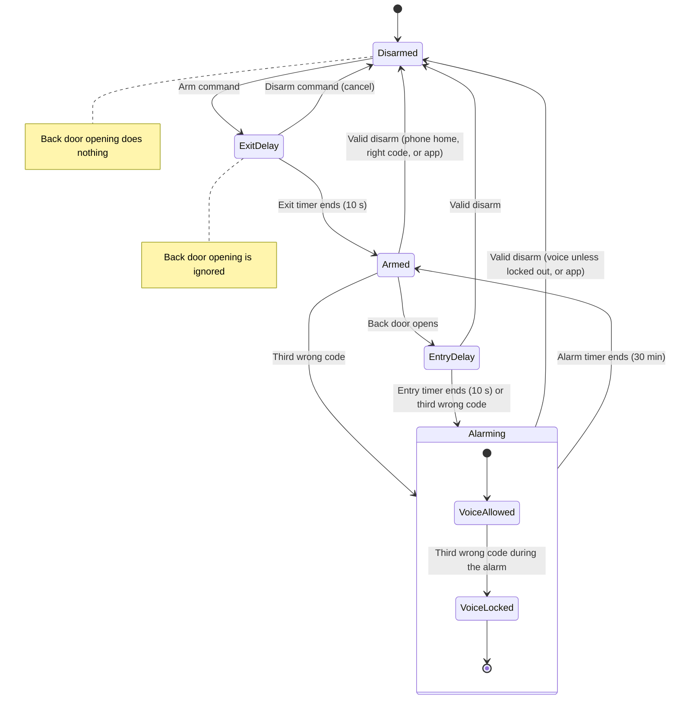

The state is kept in one Home Assistant helper with these five values, so
each state can be set directly in tests (DD-5).

### 12.2 Component Diagram: hardware connections

See Section 5.3.

## 13. Design Decisions

| ID | Decision | Options considered | Reason | Date |
|---|---|---|---|---|
| DD-1 | Build on Home Assistant OS on the Pi, configured with YAML automations, add-ons and the Companion app | Home Assistant OS; Linux with Docker; custom program | Fixed by the PRD (Section 7). Every use case fits Home Assistant's standard parts. | 2026-11-15 |
| DD-2 | Voice: Option A, phrases on the Pi (openWakeWord, Speech-to-Phrase, Piper, Assist Microphone with the Jabra) | A: phrases on the Pi; B: cloud speech and Claude; C: Whisper on the Pi | Meets the 3 s target, keeps the password on the Pi, $0 a month (d04-02). Chosen by b0ts. | 2026-11-15 |
| DD-3 | Remote access by Tailscale (add-on on the Pi, app on both iPhones) | Tailscale; Home Assistant Cloud (Nabu Casa, $6.50 a month) | No monthly cost, encrypted, no open router ports. Chosen by b0ts. Trade-off: the Tailscale app must stay connected on the phones for remote disarm. | 2026-11-15 |
| DD-4 | Zigbee through Zigbee2MQTT with the Mosquitto broker | Zigbee2MQTT; ZHA (built into Home Assistant) | Zigbee2MQTT lists the door sensor (SBDW-103C) and the plug (S4PL-00116US) explicitly. Changing later means pairing every device again. Confirmed by signing off this Spec, which must happen before any device is paired. | 2026-11-15 |
| DD-5 | The alarm is its own state machine (one helper with five states, plus timers and scripts) | Home Assistant's Manual alarm panel; own state machine | The PRD needs things the Manual panel doesn't do simply: an immediate alarm after the third wrong code, voice lockout during an alarm, disarm by phone presence. Explicit states are easier to test. | 2026-11-15 |
| DD-6 | The password is a spoken code of digits (4 proposed), stored in a password-type helper and left out of history | Spoken word password; digit code | A phrase-only recognizer could hear a wrong word as the right one. Every digit combination is a known phrase, so the code is compared exactly. Chosen by b0ts. In PRD version 1.2 (R3). | 2026-11-15 |
| DD-7 | During an alarm the plug flashes 5 s on, 5 s off. Only the porch bulb flashes SOS. | SOS on both; steady flashing on the plug | The plug is rated 10,000 cycles: SOS uses about 480 to 950 per alarm, steady flashing about 180 (Section 5.4). Chosen by b0ts. In PRD version 1.2 (R1). | 2026-11-15 |
| DD-8 | Sunrise and sunset from Home Assistant's sun integration, using the home location stored on the Pi | Sun integration; an online sunrise service | Works offline, no outside data source, standard and testable | 2026-11-15 |
| DD-9 | Keep the SONOFF SNZB-03PR2 motion sensor, under the eaves over the front door. Replace it with an outdoor-rated sensor if the weather damages it. | Keep and shelter; buy an outdoor sensor now | The eaves keep it dry, and no extra cost now. Chosen by b0ts. Resolves I6. | 2026-11-15 |
| DD-10 | Shelly BLU Door/Window ZB in Zigbee mode | Zigbee; Bluetooth | Zigbee2MQTT supports it as model SBDW-103C. No Bluetooth support needed. Resolves I5, subject to the Step 6 pairing test. | 2026-11-15 |
| DD-11 | Add "decoy" phrases for light names the house doesn't have, answered "I don't know that light" | Decoys; none | A phrase-only recognizer would otherwise map an unknown name to a real light (UC-3, 3b) | 2026-11-15 |
| DD-12 | After the 30-minute alarm ends, the system returns to Armed | Armed; Disarmed | The PRD doesn't say. Staying armed still protects the house if the household is away. | 2026-11-15 |
| DD-13 | All three disarm methods use one shared disarm script, which also stops the alarm and restores the lights | One script; separate rules per method | Same behaviour and timing for every method (UC-7). One place to test. | 2026-11-15 |

## 14. Risks

| Risk | Likelihood | Impact | What we'll do about it |
|---|---|---|---|
| The Assist Microphone add-on is unreliable with the Jabra (users report dropouts and wake-word problems), or doesn't play announcements | Medium | High (UC-3 to UC-7) | Test early in hardware stage 3. Fall back to a separate way to play announcements (product for DevOps to decide), or source a voice puck (PRD Assumptions). |
| Speech-to-Phrase hears an unknown phrase as a known one | Medium | Medium | Decoy phrases (DD-11). Spoken confirmations. 9-of-10 test in Step 7. |
| The plug wears out from alarm flashing | Low (after DD-7) | Medium | Steady flashing. Replace the plug if it fails (D7). |
| The plug is rated indoor-only and is mounted under the eaves | Medium | Medium | Accepted by b0ts. Replace it with an outdoor-rated plug if it fails. |
| The motion sensor isn't weather-rated | Medium | Medium (UC-2) | Sheltered under the eaves. Replace if needed (DD-9). |
| Zigbee signal to the back door is weak, with the Pi at the front door and perhaps only the plug relaying | Medium | High (UC-4 to UC-6) | Check the signal in hardware stage 2. Add a mains-powered Zigbee relay (TBD cost, I4) if needed. |
| The door sensor drops off the network while armed, so an entry is missed | Low | High | Mark the sensor unavailable in the app. Refuse to arm with a spoken warning if it's unavailable (for SDET to test). |
| Tailscale is off or disconnected on a phone, so remote disarm fails, or presence is late | Medium | Medium | Guide says keep Tailscale connected. Voice disarm with the code still works. |
| Phone presence lags, so a returning household member is asked for the code | Medium | Low | The code is the fallback (UC-5, 3a). |
| A household phone left at home lets anyone disarm by voice | Low | Medium | Accepted by the PRD design (prototype). Noted in the guide. |
| The 10-second entry delay is too short to reach the speakerphone (I7) | Medium | Medium | Accepted (D7). Revisit after trials. |
| SOS timing over Zigbee is uneven | Medium | Low | 1-second Morse unit. Tune in Step 6. |
| The speakerphone draws too much USB power | Low | Medium | Powered USB hub (parts list). |
| Pre-trained wake-word models are non-commercial only | Low | Low | Personal use. Flag in the guide (Section 11.2). |

## 15. Assumptions and Open Questions

**Assumptions:**

- The Jabra Speak 510 works on the Pi as both microphone and speaker with
  the Assist Microphone add-on. To confirm in hardware stage 3 (Step 6).
- Announcements (exit delay, alarm) can be played through the Jabra without
  a voice request. To confirm in Step 6.
- Home Assistant can take the code as a follow-up without a second wake
  word. If not, the guide tells people to say the wake word again. To
  confirm in Step 6.
- The Zigbee coordinator reaches the back-door sensor from the front door,
  directly or through the plug. To confirm in hardware stage 2.
- The Home Assistant app on iPhone reports home and away quickly enough for
  disarming (PRD Assumptions). To confirm in Step 6.
- The Tailscale free personal plan covers the Pi and two iPhones at no cost.
  To confirm in Step 6.

**Open questions:**

- None blocks the hand-off. PRD changes R1 to R4 are answered by PRD
  version 1.2 (Section 16); its sign-off is recorded in the Tracking chat
  together with this Spec's review. Signing off this Spec also confirms
  Zigbee2MQTT (DD-4), which must happen before any device is paired.
- Licences for Speech-to-Phrase, the Piper voice and the openWakeWord models
  (Section 11.2). Non-blocking. (DevOps, Step 6)
- What do James's answers change? The questions were sent on 2026-11-14.
  They may refine the voice, announcement and alarm details. Non-blocking.
  (b0ts)
- The hardware total (I4). (b0ts, Step 6 cost sign-off)

## 16. Requests Sent Back to the PRD

| Request | Reason | PRD version that answered it |
|---|---|---|
| R1: UC-6 step 2 and UC-7: during an alarm the Christmas-light plug flashes 5 seconds on, 5 seconds off. Only the porch light flashes SOS. Update the matching acceptance criteria and D7's note. | Hardware wear: the plug is rated for 10,000 switching cycles, and SOS for 30 minutes uses about 480 to 950 per alarm (Section 5.4) | d03-01 v1.2, 2026-11-15 |
| R2: Remove the "Cloud voice service" actor (Section 3, use case diagram, UC-3 to UC-5 and UC-7 actors). Remove UC-3's "internet is working" precondition. Change Section 6 Privacy to "no voice audio leaves the home system". | Voice design Option A (d04-02, DD-2): all voice processing is on the Pi | d03-01 v1.2, 2026-11-15 |
| R3: Define the password in UC-5, UC-7 and UC-8 as a spoken code of digits (4 digits proposed), said as "code" followed by the digits | A phrase-only recognizer needs a fixed vocabulary. Digits let every wrong code be heard as wrong (DD-6). | d03-01 v1.2, 2026-11-15 |
| R4: UC-8: the wake word is chosen from the built-in list rather than typed in | Wake words that run on the Pi come from a fixed list. A custom one would need training (d04-02). | d03-01 v1.2, 2026-11-15 |

## 17. Change Log

| Version | Date | Change | Reason | Approved by |
|---|---|---|---|---|
| 1.0 | 2026-11-15 | First version; updated to PRD version 1.2, which answers requests R1 to R4 | — | b0ts (D12) |
